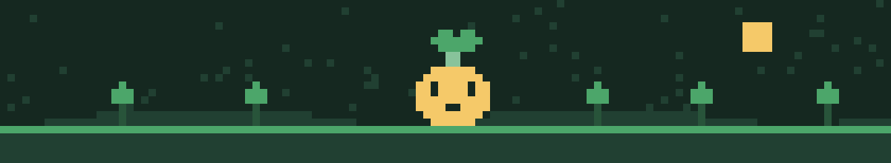
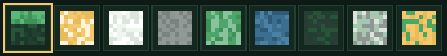
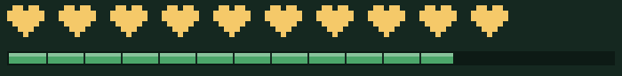

<pre>
██████████████████████████████████████████████████████
██▓▓▓▓▓▓▓▓▓▓▓▓▓▓▓▓▓▓▓▓▓▓▓▓▓▓▓▓▓▓▓▓▓▓▓▓▓▓▓▓▓▓▓▓▓▓▓▓██
██▓▓  ███████  ███████  ███████  ███████  ▓▓▓▓▓▓▓▓██
██▓▓  ██       ██   ██  ██   ██  ██   ██  ▓▓▓▓▓▓▓▓██
██▓▓  ███████  ███████  ███████  ██   ██  ▓▓▓▓▓▓▓▓██
██▓▓       ██  ██       ██   ██  ██   ██  ▓▓▓▓▓▓▓▓██
██▓▓  ███████  ██       ██   ██  ███████  ▓▓▓▓▓▓▓▓██
██████████████████████████████████████████████████████
</pre>

<h1>SPAWNLY</h1>

<h3>Encontre seu mundo perfeito.</h3>

Site de sugestões de seeds para Minecraft com questionário de preferências 
e recomendações personalizadas, construído como projeto acadêmico de CRUD.

<h2>

</h2>

<table>
<tr>
<td align="center" width="25%"><a href="#sobre-o-mundo"><b>Sobre o Mundo</b></a></td>
<td align="center" width="25%"><a href="#jornada-do-jogador"><b>Jornada do Jogador</b></a></td>
<td align="center" width="25%"><a href="#crafting-table-tecnologias"><b>Crafting Table</b></a></td>
<td align="center" width="25%"><a href="#mapa-de-chunks-arquitetura"><b>Mapa de Chunks</b></a></td>
</tr>
<tr>
<td align="center"><a href="#inventario-banco-de-dados"><b>Inventário</b></a></td>
<td align="center"><a href="#comandos-rotas-da-api"><b>Comandos</b></a></td>
<td align="center"><a href="#iniciando-o-servidor"><b>Iniciando o Servidor</b></a></td>
<td align="center"><a href="#party-equipe"><b>Party</b></a></td>
</tr>
</table>

<h3>Paleta do mundo</h3>

<h2 id="sobre-o-mundo">

</h2>

<blockquote>
<b>Advancement Made!</b> Você encontrou o Spawnly.
</blockquote>

O <b>Spawnly</b> recomenda seeds de Minecraft que combinam com o seu estilo de jogo. O usuário responde um questionário sobre edição, bioma, modo de jogo e estruturas desejadas, e o sistema retorna seeds previamente cadastradas e verificadas, ordenadas por compatibilidade.

<table>
<tr>
<td width="50%">

<ul>
<li>Cadastra usuários, preferências e seeds</li>
<li>Consulta o catálogo e as recomendações</li>
<li>Edita dados, filtros e seeds</li>
<li>Exclui registros mediante confirmação</li>
</ul>

</td>
<td width="50%">

<ul>
<li>Não descobre seeds aleatórias do jogo</li>
<li>Não simula login falso</li>
<li>Não recomenda seeds sem edição e versão</li>
</ul>

</td>
</tr>
</table>

<h3>CRUD obrigatório</h3>

<table>
<tr>
<td width="15%" align="center"></td>
<td>Cadastrar usuários, preferências e seeds.</td>
</tr>
<tr>
<td align="center"></td>
<td>Consultar cadastros, catálogo e recomendações.</td>
</tr>
<tr>
<td align="center"></td>
<td>Editar dados de usuário, filtros e seeds.</td>
</tr>
<tr>
<td align="center"></td>
<td>Excluir registros mediante confirmação.</td>
</tr>
</table>

<blockquote>
<b>Limite de escopo:</b> o site recomenda apenas seeds já registradas no MySQL. Isso mantém o trabalho realizável e as recomendações confiáveis.
</blockquote>

<h2 id="jornada-do-jogador">

</h2>

<table>
<tr>
<th align="center">Nível</th>
<th align="left">Etapa</th>
<th align="left">Descrição</th>
</tr>
<tr>
<td align="center"></td>
<td><b>Entrar ou cadastrar</b></td>
<td>Informar nome de usuário. Autenticação completa é opcional.</td>
</tr>
<tr>
<td align="center"></td>
<td><b>Responder ao questionário</b></td>
<td>Escolher Java ou Bedrock, bioma, modo de jogo e estruturas desejadas.</td>
</tr>
<tr>
<td align="center"></td>
<td><b>Ver recomendações</b></td>
<td>Receber cards com código da seed, versão, características e pontuação de compatibilidade.</td>
</tr>
<tr>
<td align="center"></td>
<td><b>Refinar preferências</b></td>
<td>Alterar filtros sem repetir todo o processo.</td>
</tr>
</table>

<pre>
Hotbar:  [ 1 Entrar ][ 2 Questionário ][ 3 Recomendações ][ 4 Refinar ]
              ▓▓▓▓          ▓▓▓▓             ▓▓▓▓            ▓▓▓▓
</pre>

<b>Slots de bioma (exemplos para o questionário)</b>

<table>
<tr>
<th>1</th><th>2</th><th>3</th><th>4</th><th>5</th><th>6</th><th>7</th><th>8</th><th>9</th>
</tr>
<tr>
<td align="center">Planície</td><td align="center">Deserto</td><td align="center">Neve</td><td align="center">Montanha</td><td align="center">Floresta</td><td align="center">Oceano</td><td align="center">Pântano</td><td align="center">Picos</td><td align="center">Savana</td>
</tr>
</table>

Os biomas reais ficam no banco de dados, na tabela <code>seeds</code>. Esta lista é só um exemplo.

<h2 id="crafting-table-tecnologias">

</h2>

<table>
<tr>
<td align="center" width="33%">  HTML5 CSS3 responsivo JavaScript</td>
<td align="center" width="33%">  Node.js Express mysql2 e body-parser</td>
<td align="center" width="33%">  MySQL MySQL Workbench Script SQL/DDL</td>
</tr>
</table>

<pre>
   RECEITA DE CRAFTING

  ┌───────┬───────┬───────┐
  │ HTML5 │ CSS3  │  JS   │
  ├───────┼───────┼───────┤       ┌─────────────┐
  │ Node  │Express│ MySQL │ ───►  │  SPAWNLY x1 │
  ├───────┼───────┼───────┤       └─────────────┘
  │ mysql2│ body- │  DDL  │
  │       │ parser│       │
  └───────┴───────┴───────┘
</pre>

<h2 id="mapa-de-chunks-arquitetura">

</h2>

<pre>
 ┌──────────────────┐      ┌──────────────────┐      ┌──────────────────┐
 │    FRONT-END     │      │     BACK-END     │      │      DADOS       │
 │                  │ ───► │                  │ ───► │                  │
 │ HTML5 + CSS3 + JS│ ◄─── │ Node.js + Express│ ◄─── │ MySQL / Workbench│
 └──────────────────┘      └──────────────────┘      └──────────────────┘
      Navegador                 API REST                  Banco de dados
</pre>

<b>Estrutura de pastas sugerida</b>

<pre>
spawnly/
├── package.json
├── server.js
├── README.md
├── assets/
├── database/
│   └── schema.sql
├── src/
│   ├── db.js
│   └── routes/
│       ├── seeds.js
│       ├── usuarios.js
│       ├── preferencias.js
│       └── recomendar.js
└── public/
    ├── index.html
    ├── questionario.html
    ├── resultados.html
    ├── gerenciar.html
    ├── css/
    └── js/
</pre>

A estrutura acima é uma sugestão. Ajuste os nomes conforme o que for combinado pela equipe.

<h2 id="inventario-banco-de-dados">

</h2>

<table>
<tr>
<th align="left">Tabela</th>
<th align="left">Campos</th>
<th align="left">Função</th>
</tr>
<tr>
<td><code>usuarios</code></td>
<td><code>id</code>, <code>nome</code>, <code>nickname</code>, <code>email</code> (opcional)</td>
<td>Cadastro e manutenção de usuários</td>
</tr>
<tr>
<td><code>preferencias</code></td>
<td><code>id</code>, <code>usuario_id</code>, <code>edicao</code>, <code>bioma</code>, <code>estilo</code>, <code>detalhes</code></td>
<td>Preferências editáveis do questionário</td>
</tr>
<tr>
<td><code>seeds</code></td>
<td><code>id</code>, <code>codigo</code>, <code>edicao</code>, <code>versao</code>, <code>bioma</code>, <code>estruturas</code>, <code>descricao</code></td>
<td>Catálogo de mundos recomendáveis</td>
</tr>
</table>

<pre>
 ┌──────────────┐ 1      N ┌────────────────┐
 │   usuarios   │──────────│  preferencias  │
 └──────────────┘          └────────────────┘

 ┌──────────────┐
 │    seeds     │   (catálogo independente, consultado pelas regras
 └──────────────┘    de recomendação)
</pre>

<blockquote>
<b>Atenção:</b> o código da seed deve ser armazenado como <b>texto</b> (<code>VARCHAR</code>), pois pode ter muitos dígitos. Registrar <b>edição</b> e <b>versão</b> evita recomendações enganosas, já que a mesma seed gera mundos diferentes entre versões.
</blockquote>

<h2 id="comandos-rotas-da-api">

</h2>

<table>
<tr>
<th align="center">Método</th>
<th align="left">Rota</th>
<th align="left">Descrição</th>
</tr>
<tr>
<td align="center"></td>
<td><code>/api/seeds</code></td>
<td>Listar e filtrar seeds</td>
</tr>
<tr>
<td align="center"></td>
<td><code>/api/seeds</code></td>
<td>Cadastrar seed</td>
</tr>
<tr>
<td align="center"></td>
<td><code>/api/seeds/:id</code></td>
<td>Alterar seed</td>
</tr>
<tr>
<td align="center"></td>
<td><code>/api/seeds/:id</code></td>
<td>Excluir seed</td>
</tr>
<tr>
<td align="center"></td>
<td><code>/api/recomendar</code></td>
<td>Pontuar opções conforme as preferências do usuário</td>
</tr>
</table>

As rotas de usuários e preferências seguem o mesmo padrão CRUD.

<h3>Console do servidor (exemplo)</h3>

<pre>
&gt; /seed buscar --edicao java --bioma floresta --estrutura vilarejo
[Spawnly] Lendo preferências do jogador...
[Spawnly] Pontuando seeds do catálogo...
[Spawnly] 3 mundos encontrados, ordenados por compatibilidade.
</pre>

<h3>Como a recomendação funciona</h3>

A rota <code>/api/recomendar</code> compara <b>edição</b>, <b>versão</b>, <b>bioma</b> e <b>estruturas desejadas</b> com cada seed do catálogo, calcula uma pontuação de compatibilidade e devolve os resultados ordenados do maior para o menor.

<h2 id="iniciando-o-servidor">

</h2>

<h3>Requisitos</h3>

<table>
<tr>
<td align="center"> versão LTS</td>
<td align="center"> com Workbench</td>
<td align="center"> gerenciador de pacotes</td>
</tr>
</table>

<h3>Passo 1: Clonar o repositório</h3>

Conquista desbloqueada: <b>Primeiro Spawn</b>

<pre><code>git clone https://github.com/SEU-USUARIO/spawnly.git
cd spawnly</code></pre>

<h3>Passo 2: Instalar as dependências</h3>

Conquista desbloqueada: <b>Coletando Recursos</b>

<pre><code>npm install</code></pre>

Caso esteja criando o projeto do zero:

<pre><code>npm init -y
npm i express mysql2 body-parser</code></pre>

<h3>Passo 3: Criar o banco de dados</h3>

Conquista desbloqueada: <b>Construindo a Base</b>

<ol>
<li>Abra o <b>MySQL Workbench</b> e conecte ao seu servidor local.</li>
<li>Abra o arquivo <code>database/schema.sql</code>.</li>
<li>Execute o script completo. Ele cria o banco, as tabelas <code>usuarios</code>, <code>preferencias</code> e <code>seeds</code>, e as chaves primárias e estrangeiras.</li>
</ol>

<h3>Passo 4: Configurar a conexão</h3>

Conquista desbloqueada: <b>Redstone Conectada</b>

Ajuste os dados de conexão com o MySQL no módulo de acesso ao banco (por exemplo <code>src/db.js</code>):

<pre><code>const config = {
  host: "localhost",
  user: "seu_usuario",
  password: "sua_senha",
  database: "spawnly"
};</code></pre>

<h3>Passo 5: Iniciar o servidor</h3>

Conquista desbloqueada: <b>Servidor no Ar</b>

<pre><code>node server.js</code></pre>

<h3>Passo 6: Abrir no navegador</h3>

Conquista desbloqueada: <b>Mundo Aberto</b>

<pre><code>http://localhost:3000</code></pre>

A porta pode variar conforme a configuração do <code>server.js</code>.

<h2>

</h2>

<table>
<tr>
<th align="center" width="10%">Status</th>
<th align="left">Item</th>
</tr>
<tr><td align="center">[ ]</td><td>Páginas de cadastro em HTML5 e estilização em CSS3</td></tr>
<tr><td align="center">[ ]</td><td><code>package.json</code> e pacotes <code>express</code>, <code>mysql2</code> e <code>body-parser</code> instalados</td></tr>
<tr><td align="center">[ ]</td><td>Servidor JavaScript conectado ao MySQL</td></tr>
<tr><td align="center">[ ]</td><td>Inclusão, consulta, alteração e exclusão demonstradas ao vivo</td></tr>
<tr><td align="center">[ ]</td><td>Script SQL/DDL executável via MySQL Workbench</td></tr>
<tr><td align="center">[ ]</td><td><code>README.md</code> com passos de instalação, configuração e execução</td></tr>
<tr><td align="center">[ ]</td><td>Questionário que apresenta e refina recomendações de seeds</td></tr>
</table>

<blockquote>
<b>Critério de pronto:</b> outro integrante deve conseguir instalar o projeto seguindo este README e demonstrar o CRUD completo sem editar o código.
</blockquote>

<h3>Riscos a evitar</h3>

<blockquote>
<b>Evite estes erros:</b>
<ul>
<li>Seeds sem versão ou edição</li>
<li>Botões sem conexão real com o banco</li>
<li>Login falso</li>
<li>README incompleto</li>
<li>Tarefas divididas sem contrato de API</li>
</ul>
</blockquote>

<h2 id="party-equipe">

</h2>

<table>
<tr>
<th align="center">Jogador</th>
<th align="center">Classe</th>
<th align="left">Responsabilidades</th>
</tr>
<tr>
<td align="center"><b>Vitor</b></td>
<td align="center"></td>
<td>Modelo no Workbench, script SQL/DDL, páginas HTML5, CSS3 responsivo e integração dos formulários com o servidor</td>
</tr>
<tr>
<td align="center"><b>Caetano</b></td>
<td align="center"></td>
<td>Projeto Node.js, configuração do Express, conexão reutilizável com MySQL e integração com o front-end</td>
</tr>
<tr>
<td align="center"><b>João Lima</b></td>
<td align="center"></td>
<td>CRUD de seeds, usuários e preferências, regras de recomendação e validação dos endpoints</td>
</tr>
<tr>
<td align="center"><b>Nathaniel</b></td>
<td align="center"></td>
<td>Função ainda não confirmada pelo grupo. Sugestões: testes de qualidade, documentação, curadoria de seeds e suporte ao front-end</td>
</tr>
</table>

<h3>Roteiro de entrega</h3>

<pre>
 ETAPA 1            ETAPA 2            ETAPA 3            ETAPA 4
 ┌──────────┐       ┌──────────┐       ┌──────────┐       ┌──────────┐
 │ Decidir  │ ───►  │ Construir│ ───►  │ Integrar │ ───►  │ Preparar │
 │ campos e │       │ módulos  │       │ e testar │       │ apresen- │
 │ papéis   │       │          │       │          │       │ tação    │
 └──────────┘       └──────────┘       └──────────┘       └──────────┘
</pre>

<pre>
▓▓▓▓▓▓▓▓▓▓▓▓▓▓▓▓▓▓▓▓▓▓▓▓▓▓▓▓▓▓▓▓▓▓▓▓▓▓▓▓
░░░░░░░░░░░░░░░░░░░░░░░░░░░░░░░░░░░░░░░░
████████████████████████████████████████
</pre>

  

Centro Universitário do Distrito Federal (UDF)  

<i>Que o seu próximo mundo seja o melhor já gerado.</i>

